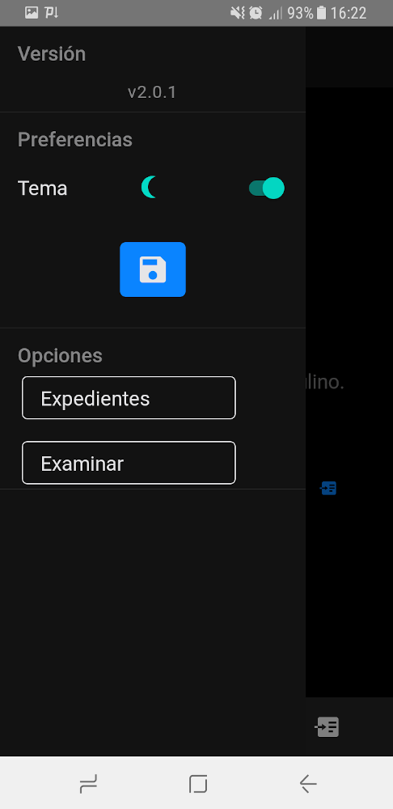
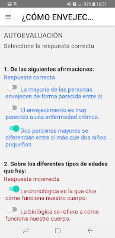
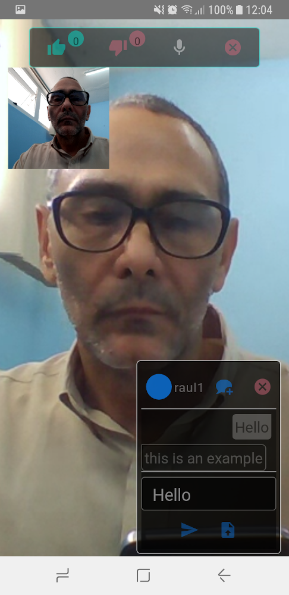
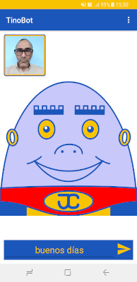
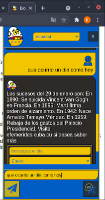
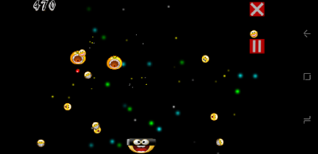

# 👋 Hi, I’m @raulglezrdguez

- 👀 I’m interested in develop apps for backend, Web and mobile using MERN stack, Next.js and React Native.

- 🌱 I’m currently learning aws.

- 💞️ I’m looking to collaborate on projects with the javascript/typescript stack.

- 📫 How to reach me ...

## Here you have some of the last projects I developed using react native.

### App for apply exams to patients.

### Interactive book.

### Video chat using WebRTC (peerjs).

## Here you have a project I developed using python and kotlin.

### A chatbot. The server with Python/Flask/spacy the Web with javascript/css and the mobile with kotlin.

Mobile screenshot.

Web screenshot.

## Here you have a videogame I developed using Haxe/openfl.

<!---
raulglezrdguez/raulglezrdguez is a ✨ special ✨ repository because its `README.md` (this file) appears on your GitHub profile.
You can click the Preview link to take a look at your changes.
--->
